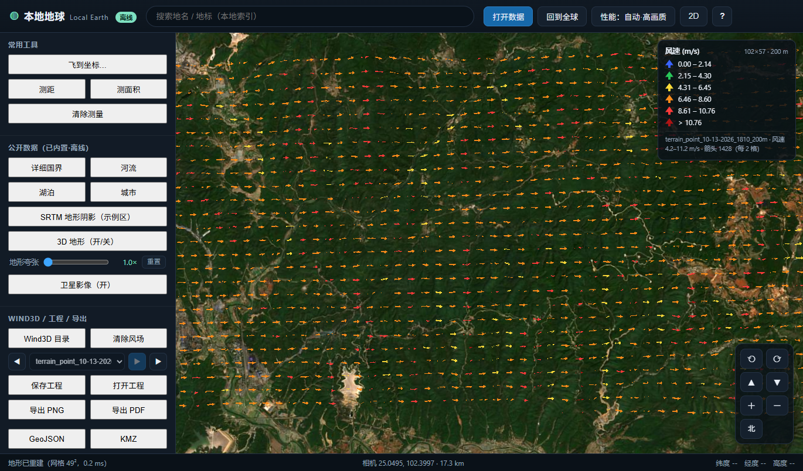
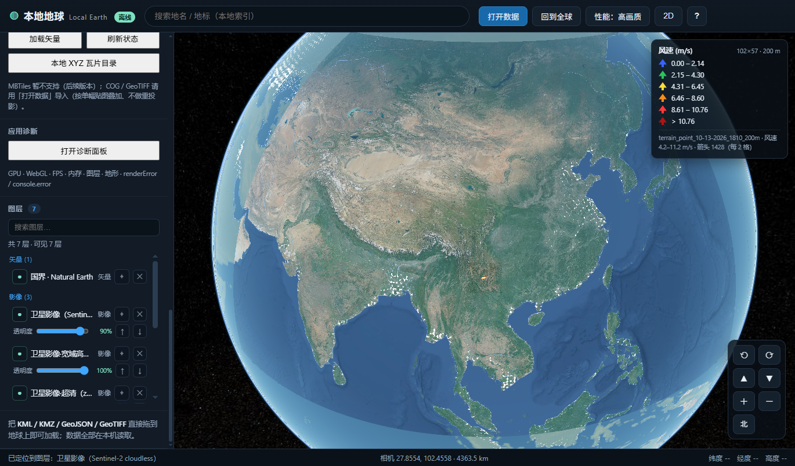
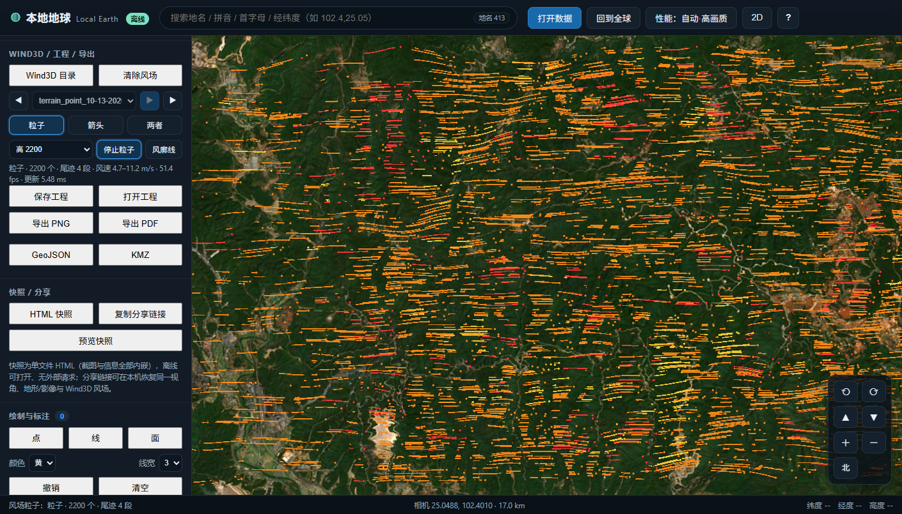
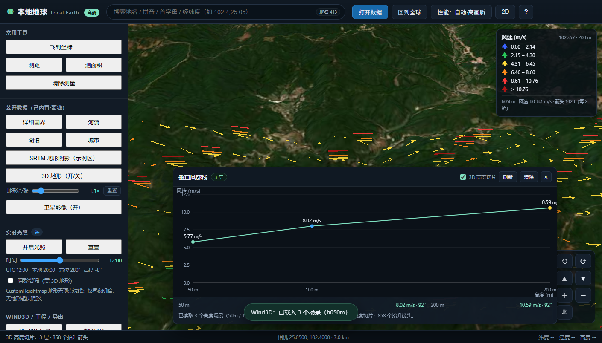
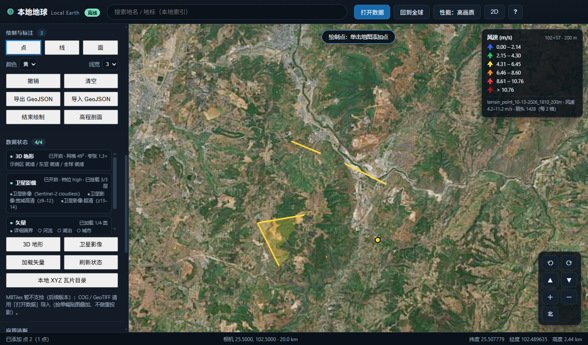
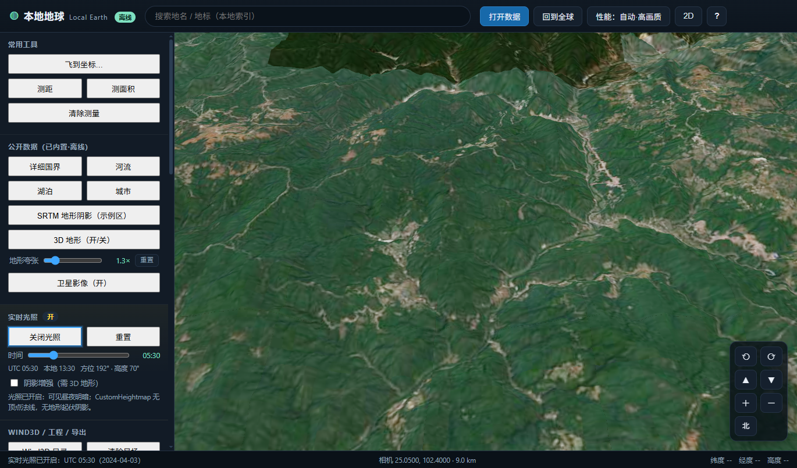
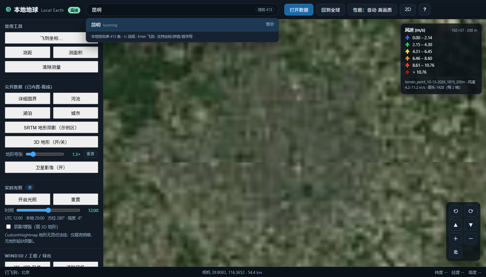
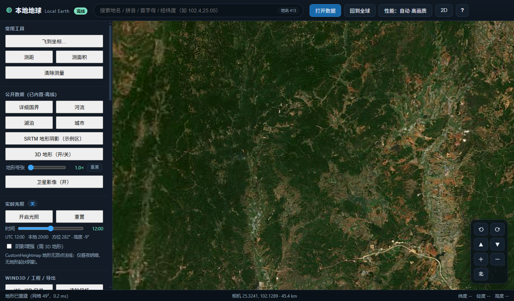

# 猫猫地球 · MaomaoEarth

> 完全离线、双击即用的 Windows 三维地理信息工具：本地地形、卫星影像、KML/KMZ、WindNinja/Wind3D 风场直读、粒子/风廓线、工程保存与离线出图。
>
> **v0.4.0** · Windows 10/11 · 无需安装、无需联网、无需构建



---

## 这是什么

MaomaoEarth（猫猫地球）是一个**本地优先**的三维地球应用，面向需要在内网/断网环境查看地形、影像、风场和矢量数据的用户：

- 双击 `MaoMaoEarth.exe` 启动本地服务，并用 Edge/Chrome 的应用窗口打开；
- 所有地图、地形、矢量、风场数据都在本机 `data/` 目录，运行时不请求互联网；
- 同时保留**浏览器版、CLI、JavaScript API**，方便二次开发和自动化；
- 覆盖从“看地形/影像”到“加载 WindNinja 结果 → 箭头/粒子 → 风廓线 → 出图/分享”的完整流程。

> 数据来源与许可见 [docs/DATA-LICENSES.md](docs/DATA-LICENSES.md)。地形/影像为科研与演示用途，不作为测绘或工程法定依据。

---

## 功能亮点

- **三维地形**：全球 0.1° 底图 + 东亚 0.02° + 风场区 1″ 高精度网格；地形夸张、3D/2D 切换、地形阴影。
- **离线影像**：NASA Blue Marble 全球底图；Sentinel-2 cloudless 东亚 z5–z8、宽域 z9–z12、风场区 z13–z14；支持本地 XYZ 目录与 GeoTIFF。
- **MBTiles 直读**：`MaoMaoEarth.exe mbtiles 文件.mbtiles` 启动本地瓦片服务，按 z/x/y 查 SQLite（winsqlite3，不整库载入），支持 png/jpg/webp、TMS/XYZ、图层透明度/排序。
- **矢量数据**：Natural Earth 详细国界/河流/湖泊/城市；国界/河流按地形高度贴地绘制，城市点按距离显隐。
- **Wind3D / WindNinja 直读**：读取 `*_vel.asc` + `*_ang.asc` + `.prj`，自动 UTM→WGS84，彩色贴地箭头、风速图例、多时间/高度场景切换。
- **风场粒子**：600/1200/2200 粒子三档，双线性插值风向/风速，尾迹沿风向；与箭头/两者模式切换。
- **垂直风廓线**：多高度目录（h050m/h100m/h200m）点选地图，绘制高度-风速曲线；3D 高度切片。
- **KML/KMZ**：原生渲染，支持静态线/面、图标箭头贴地、时间轴动画、图例、135k 点大数据抽稀。
- **交互分析**：地名/拼音/坐标搜索、测距/测面积、绘制点/线/面、高程剖面、实时光照、图层管理器。
- **工程与出图**：`.leproj` 保存/恢复视角与图层；PNG/PDF/GeoJSON/KMZ 导出；HTML 快照与分享链接。
- **性能与诊断**：自动/流畅/均衡/高画质四档、GPU/内存/FPS/错误诊断面板、崩溃日志。
- **完全离线**：CSP 仅允许 `self/blob:/data:`，服务仅监听 `127.0.0.1`。

---

## 截图

| 图层管理器 + 风场 | 风场粒子 |
|---|---|
|  |  |

| 垂直风廓线 | 绘制与标注 |
|---|---|
|  |  |

| 实时光照 | 离线地名/坐标搜索 |
|---|---|
|  |  |

| MBTiles 直读 | |
|---|---|
|  | 本地 SQLite 瓦片服务 + ImageryProvider |

---

## 快速开始

### 方式 A：下载 Release（推荐，普通用户）

1. 打开仓库的 **Releases** 页面，下载：
   - `maomaoearth-v0.4.0.zip`（代码/程序，含 `MaoMaoEarth.exe`）
   - `maomaoearth-data-<日期>.zip`（离线数据包，约 190 MB）
2. 解压程序包到任意目录（路径尽量不含空格）。
3. 把数据包解压到同一目录，得到 `data/public/...`（覆盖/合并 `data` 目录）。
4. 双击 **`MaoMaoEarth.exe`**，等待应用窗口打开。

> 仓库源码出于体积原因**不包含**大型栅格/影像瓦片（见“数据包说明”）。没有数据包时程序仍可启动，但地形/卫星影像/底图瓦片会缺失。
>
> MBTiles 使用：`MaoMaoEarth.exe mbtiles "D:\data\china.mbtiles"`，详见 [docs/MBTILES.md](docs/MBTILES.md)。

### 方式 B：从源码 + 数据包

```bat
git clone https://github.com/maomao3334/maomaoearth.git
cd maomaoearth
:: 下载 Release 中的 maomaoearth-data-*.zip，解压到当前目录（合并 data/）
MaoMaoEarth.exe
```

### 方式 C：浏览器版（开发/调试）

```bat
start.cmd
:: 或
powershell -NoProfile -ExecutionPolicy Bypass -File serve.ps1 -Port 8123
```

然后访问 `http://127.0.0.1:8123/`。

### 方式 D：CLI

```bat
maomaoearth.cmd check
maomaoearth.cmd serve --port 8123 --no-browser
maomaoearth.cmd stop
maomaoearth.cmd windninja "D:\Wind3D\results\case\windninja\20240403T080600Z\h050m\r0200m"
maomaoearth.cmd mbtiles "D:\data\china.mbtiles"
```

完整命令见 [docs/CLI.md](docs/CLI.md)。

---

## 数据包说明

仓库保留：代码、Cesium 引擎、少量样例 KMZ、Natural Earth 矢量、WindNinja 样例。
Release 数据包补充：

```
data/public/dem/*.bin / *.png / *.hgt.gz     # 全球/东亚/1″ 地形与阴影
data/public/imagery/s2cloudless/             # Sentinel-2 影像瓦片
data/public/imagery/blue-marble-21600.jpg    # Blue Marble 原图
data/public/tiles/                           # Blue Marble z0–z5 底图瓦片
```

解压数据包后目录结构：

```text
maomaoearth/
  MaoMaoEarth.exe
  maomaoearth.cmd
  start.cmd / serve.ps1
  index.html
  js/ css/ vendor/
  data/
    public/{dem,imagery,tiles,vectors,places}
    samples/{wind,windninja}
  docs/
```

---

## Wind3D / WindNinja 工作流

支持直接读取 WindNinja 输出目录（无需先转 KMZ）：

```text
windninja/
  20240403T080600Z/
    h050m/r0200m/
      terrain_point_..._vel.asc   # 风速 m/s
      terrain_point_..._ang.asc   # 角度 0–360
      terrain_point_..._200m.prj  # UTM 投影（WGS84/Transverse Mercator）
```

进入应用后：

1. 点「Wind3D 目录」选择结果文件夹（可含多个时间/高度子目录）；
2. 自动解析 ASC/PRJ、UTM→WGS84，生成彩色贴地箭头/图例；
3. 选择时间/高度场景，切换「粒子 / 箭头 / 两者」；
4. 点「风廓线」→ 地图选点 → 查看高度-风速曲线，或打开 3D 高度切片；
5. 需要出图：PNG / PDF / GeoJSON / KMZ，或生成 HTML 快照。

也可用 URL 直接打开样例/结果：

```text
http://127.0.0.1:8123/?windninja=data/samples/windninja/terrain_point_10-13-2026_1810_200m_vel.asc
http://127.0.0.1:8123/?windninja=..._vel.asc&windmode=particles&particles=2200&exag=1.3
```

详见 [docs/WINDNINJA.md](docs/WINDNINJA.md)、[docs/PARTICLES.md](docs/PARTICLES.md)、[docs/WIND-PROFILE.md](docs/WIND-PROFILE.md)。

---

## 功能与阶段

### P0：数据与可用性

| 功能 | 说明 |
|---|---|
| 3D 地形 | 全球/东亚/1″ 高度网格，夸张、阴影、按性能档加载 |
| 离线影像 | Blue Marble + Sentinel-2 cloudless（CC BY 4.0） |
| 矢量 | Natural Earth 国界/河流/湖泊/城市，贴地、按距离显隐 |
| KML/KMZ | 原生渲染、动画时间轴、图例、箭头贴地 |
| Wind3D 直读 | ASC/PRJ/UTM，箭头/图例/场景切换 |
| 工程 | `.leproj` 保存/恢复相机、地形、图层、Wind3D |
| 导出 | PNG、PDF、GeoJSON、KMZ |
| MBTiles | 本地 SQLite 瓦片直读（png/jpg/webp，TMS/XYZ） |
| 打包/CLI/API | `MaoMaoEarth.exe`、`maomaoearth.cmd`、`MaoMaoEarth` JS API |

### P1：交互与分析

| 功能 | 说明 |
|---|---|
| 实时光照 | 昼夜/时间滑杆、阴影增强（受高度网格法线限制，见限制） |
| 图层管理器 | 搜索、分组、显隐、定位、删除、影像透明度/排序 |
| 诊断 | GPU/WebGL/FPS/内存/图层/地形/错误堆栈，复制/下载 |
| 绘制 | 点/线/面、撤销/清空、GeoJSON 导入导出 |
| 高程剖面 | 沿线采样、曲线、最低/最高/累计爬升、导出 PNG |
| 数据面板 | 地形/影像/矢量状态、一键加载、本地 XYZ 目录 |

### P2：高级可视化与分享

| 功能 | 说明 |
|---|---|
| 风场粒子 | 600/1200/2200 粒子、尾迹、按风速着色、箭头/粒子切换 |
| 风廓线 | 多高度点选曲线、3D 高度切片 |
| 地名增强 | 413 条中国城市、拼音/首字母/别名、经纬度输入、最近搜索 |
| HTML 快照 | 单文件 HTML（内嵌截图/相机/图层/版权） |
| 分享链接 | 含 cam/exag/terrain/imagery/windninja/perf 等参数 |

---

## 交互速查

| 操作 | 说明 |
|---|---|
| 左键拖拽 | 旋转视角 |
| 右键拖拽 | 缩放 |
| 滚轮 | 缩放 |
| 双击 | 默认定位/跟踪；绘制模式下结束线/面 |
| `Esc` | 退出绘制/取消当前操作 |
| 顶部搜索 | 中文/拼音/坐标，回车飞行 |
| 右侧按钮 | 指北、俯视、缩放、2D/3D |
| 侧栏 | 数据、图层、Wind3D、光照、绘制、诊断、工程、导出 |

---

## API / 二次开发

浏览器全局对象 `window.MaoMaoEarth`（详见 [docs/API.md](docs/API.md)）：

```js
await MaoMaoEarth.ready();

MaoMaoEarth.flyTo(102.4, 25.05, 9000, 0, -50);
await MaoMaoEarth.load('data/samples/wind/wind3d_test.kmz');
await MaoMaoEarth.windninja.loadUrl('data/samples/windninja/..._vel.asc');

MaoMaoEarth.particles.start({ density: 1200 });
MaoMaoEarth.windProfile.open();
MaoMaoEarth.lighting.setEnabled(true);

MaoMaoEarth.project.save();
MaoMaoEarth.export.png({ scale: 2 });
MaoMaoEarth.snapshot.downloadHtml();
```

底层对象同样可用：`LE`、`LETerrain`、`LEKml`、`LEWindninja`、`LEWindParticles`、`LEProject`、`LEExport` 等。

---

## 目录结构

```text
local-earth/
  MaoMaoEarth.exe            # 免安装启动器（.NET Framework，25 KB）
  maomaoearth.cmd            # CLI 包装
  start.cmd / serve.ps1      # 浏览器版启动
  index.html                 # 单页应用
  js/
    mbtiles.js               # MBTiles 本地瓦片服务客户端（v0.4.0）
    main.js                  # 启动、Cesium Viewer、LE API
    terrain.js               # 地形/影像/高度查询
    kml-native.js            # KML/KMZ 原生渲染
    importers.js             # 文件/URL 导入、GeoJSON 清洗
    windninja.js             # WindNinja 直读（P0）
    wind-particles.js        # 风场粒子（P2）
    wind-profile.js          # 风廓线/3D 切片（P2）
    project.js / exporter.js # 工程与导出（P0）
    lighting.js / layers-panel.js / diagnostics.js / draw.js / profile.js  # P1
    places.js / snapshot.js  # P2
    api.js                   # 稳定二次开发 API
  css/app.css
  vendor/cesium/             # CesiumJS 1.146（离线）
  data/
    public/{dem,imagery,tiles,vectors,places}
    samples/{wind,windninja}
  docs/                      # 全部说明与验收记录
  tools/                     # 启动器编译、数据包、DEM/瓦片生成脚本
  packaging/                 # C# 启动器源码
```

---

## 性能与档位

- 顶部「性能」按钮循环：**自动 → 流畅 → 均衡 → 高画质**；URL `?perf=auto|low|medium|high`。
- 自动档会根据 GPU、核心数、内存、FPS 自动升降级；也可手动固定。
- 高画质：地形 49×49、影像全开、粒子 2200、箭头每 2 格；
- 流畅：地形 17×17、影像精简、粒子 600、箭头每 4 格；
- 弱显卡建议「流畅/均衡」，并关闭不必要的影像层。

---

## 数据来源与许可

| 数据/组件 | 来源 | 许可 |
|---|---|---|
| CesiumJS 1.146 | CesiumGS | Apache-2.0 |
| geotiff.js | geotiffjs | MIT |
| Blue Marble 底图 | NASA | 公有领域 |
| Natural Earth 10m 矢量 | Natural Earth | 公有领域 |
| Sentinel-2 cloudless | EOX IT Services GmbH | **CC BY 4.0**（须注明来源） |
| SRTM / ETOPO / 公开 DEM | NASA / NOAA | 公有领域/开放 |
| WindNinja 样例 | 本地生成 | 用户自备 |

**必须保留的影像署名**：`Sentinel-2 cloudless by EOX IT Services GmbH (CC BY 4.0)`，https://s2maps.eu
完整许可见 [docs/DATA-LICENSES.md](docs/DATA-LICENSES.md)；代码许可见 [LICENSE](LICENSE)。

---

## 验证记录

三个阶段都有自动化验收（headless Edge + CDP，截图与统计）：

- [P0 验收](docs/P0-VERIFICATION.md)：EXE/CLI、Wind3D、工程、导出
- [P1 验收](docs/P1-VERIFICATION.md)：光照、图层、诊断、绘制、剖面（77/77）
- [P2 验收](docs/P2-VERIFICATION.md)：粒子方向回归、风廓线、搜索、快照、P0/P1 回归
- [MBTiles 说明与验证](docs/MBTILES.md)：本地 SQLite 瓦片服务、TMS、测试记录

---

## 已知限制

- **地形光照**：高度网格无顶点法线，Cesium 只做昼夜明暗，没有地形起伏自阴影；可用“阴影增强”突出预烘焙 hillshade。
- **影像范围**：Sentinel-2 仅覆盖东亚/风场区，其他区域为 Blue Marble；高精度影像需按脚本自行扩展。
- **地形精度**：0.1°/0.02°/1″ 为再采样产品，非测绘精度。
- **MBTiles**：支持 WebMercator 栅格 png/jpg/webp；pbf 矢量瓦片与 EPSG:4326 瓦片未支持；需通过 `MaoMaoEarth.exe mbtiles` 启动瓦片服务，工程暂不保存。
- **Wind3D**：仅 ESRI ASCII + WGS84/UTM；粒子为 CPU 更新、不含垂直速度；风廓线为单点。
- **工程**：不内嵌本地 KML/KMZ/GeoTIFF；Wind3D 仅保存当前场景。
- **快照**：HTML 为静态图片+信息，非交互地图；headless 浏览器下载可能被取消。
- **KMZ 导出**：store 不压缩，不含时间动画。
- 已知偶发 SRTM 阴影图层重复（terrain 挂载竞态），重载可恢复。

---

## 开发与构建

本项目**没有前端构建步骤**，改完 JS 刷新页面即可。

```bat
:: 浏览器版
powershell -NoProfile -ExecutionPolicy Bypass -File serve.ps1 -Port 8123

:: 重新编译免安装启动器（需要 Windows 自带 .NET Framework）
powershell -NoProfile -ExecutionPolicy Bypass -File tools/build-launcher.ps1

:: 生成 Release 数据包
powershell -NoProfile -ExecutionPolicy Bypass -File tools/make-data-pack.ps1
```

数据生成工具：`tools/make_world_terrain.py`、`make_eastasia_terrain.py`、`make_n25_fullres_terrain.py`、`download_s2_tiles.py` 等（需 Python 与网络，仅开发时使用）。

---

## FAQ

**Q：没有数据包能启动吗？**
A：可以启动和加载 KML/矢量，但地形/卫星影像/底图瓦片缺失。请下载 Release 数据包解压到项目根目录。

**Q：双击 EXE 没反应？**
A：查看同目录 `maomaoearth.log`；确认 `index.html`/`serve.ps1` 与 EXE 同级；Edge/Chrome 是否存在。可运行 `MaoMaoEarth.exe check`。

**Q：端口 8123 被占用？**
A：启动器会自动换端口；CLI 也可 `--port 9000`。已运行同一应用会复用。

**Q：完全断网能用吗？**
A：能。服务仅监听 `127.0.0.1`，CSP 仅允许 `self/blob:/data:`，不加载在线地图/CDN/字体。

**Q：如何把自己的 WindNinja 结果给别人？**
A：分享 `.leproj` + 原始 Wind3D 目录，或导出 PNG/PDF/HTML 快照；分享链接仅本机有效。

**Q：可以二次开发吗？**
A：可以。使用 `window.MaoMaoEarth` API 或直接调用 `LE*` 模块；CLI 保留 `serve/check/stop/windninja`。

---

如果这个项目对你有帮助，欢迎 Star / Issue 反馈。
